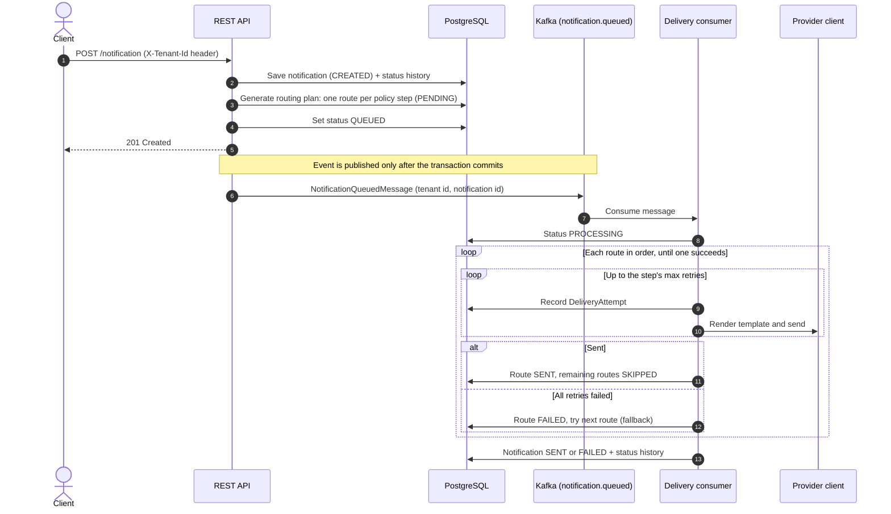

# Notification Service

A multi-tenant, event-driven notification service built with Java 21 and Spring Boot 3.5. It accepts notification requests over REST, plans a delivery route for each one from a routing policy, and delivers it asynchronously through Kafka, trying channels in order with retries and fallback. Every attempt and every status change is recorded, so the full delivery history of a notification can be traced.

This is a personal learning and portfolio project that is still evolving. See [Current status](#current-status) for what is finished and what is not.

## How it works



## Design decisions

- **Submission is separate from delivery.** The API only stores the notification and its routing plan. Delivery happens in a Kafka consumer, so a slow or failing provider never blocks the caller.
- **Publish after commit.** The Kafka message is sent from a `@TransactionalEventListener(phase = AFTER_COMMIT)`, so a message is never published for a notification that was not saved.
- **Routing policies with fallback.** A `RoutingPolicy` is a list of ordered `RoutingPolicyStep`s, for example "email via SMTP, then SMS via Twilio". Each step has its own retry limit. The first successful step wins, and the remaining steps are marked `SKIPPED`.
- **Pluggable providers.** SMTP, SendGrid and Twilio clients implement one `NotificationProviderClient` interface, and a `ProviderFactory` picks the right one at runtime. Adding a provider means adding one class.
- **Full delivery history.** `DeliveryAttempt` records each try, and `NotificationStatusHistory` records each status change with a reason.
- **Tenant context per request.** A `TenantContextFilter` reads the tenant from the `X-Tenant-Id` header (or from an authenticated `TenantAwarePrincipal`), and tenant-scoped entities extend `TenantBaseEntity`. The consumer restores the tenant context from the Kafka message.
- **Templates.** Messages are rendered from stored templates with typed template variables before sending.
- **Validation and errors.** A custom `@NotificationPayload` validator checks request payloads, a global exception handler returns consistent error responses, and messages are resource-bundle based.

### Status values

| Entity | Statuses |
|---|---|
| Notification | `CREATED` → `QUEUED` → `PROCESSING` → `SENT` / `FAILED` |
| Route (one per policy step) | `PENDING` → `PROCESSING` → `SENT` / `FAILED` / `SKIPPED` |

## Tech stack

Java 21 · Spring Boot 3.5 · Spring Web · Spring Data JPA · Spring Security · Spring Kafka · PostgreSQL · Bean Validation · Lombok · Maven · Docker Compose

## Running locally

Requirements: Java 21, Docker, and a Kafka broker on `localhost:9092`.

1. Start PostgreSQL (and the optional RabbitMQ and pgAdmin containers):
   ```bash
   docker compose up -d
   ```
2. Start a Kafka broker on `localhost:9092`. Kafka is not part of `docker-compose.yml` yet.
3. Run the service:
   ```bash
   ./mvnw spring-boot:run
   ```
   The service listens on port 8080. Hibernate creates the schema on start-up (`ddl-auto: update`).

The credentials in `docker-compose.yml` and `application.yaml` are for local development only.

## Current status

Done:
- Domain model for notifications, templates, providers, channels, routing policies, routes, delivery attempts and status history
- REST submission, routing-plan generation, after-commit Kafka publishing, and the Kafka delivery consumer with retries and fallback
- Tenant context propagation, payload validation and centralised error handling

In progress / not yet done:
- **Provider clients are simulated.** The SMTP, SendGrid and Twilio clients return a fake successful result; no real email or SMS is sent yet.
- **Authentication is not wired yet.** Spring Security requires an authenticated request, but no login mechanism (for example JWT) is configured, so the API cannot be called without adding one.
- **Tenant isolation is partial.** The tenant id is stored and propagated, but queries are not yet filtered by tenant everywhere.
- **Tests.** Only a context-load test exists; unit and Testcontainers-based integration tests are next.
- **RabbitMQ** is included as a dependency and container for planned work, but the current delivery flow uses Kafka only.
- **Kafka** still needs to be added to `docker-compose.yml`.
